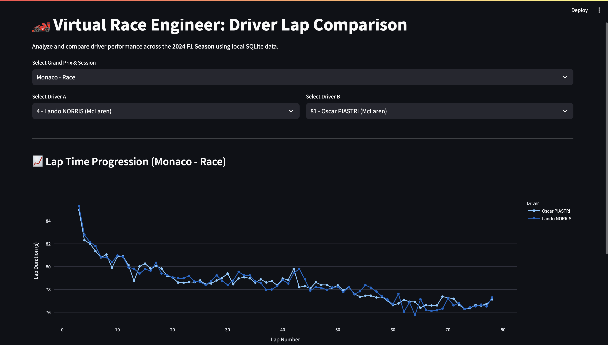
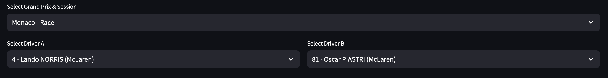
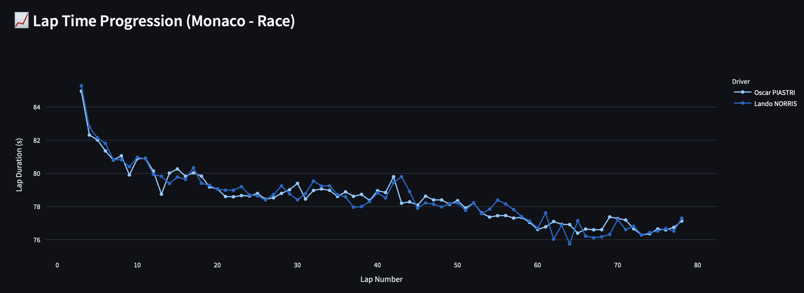
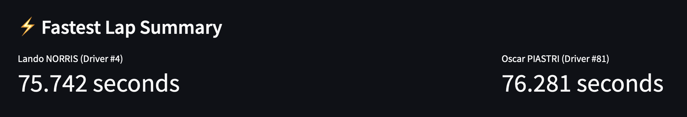

# F1 Virtual Race Engineer

Analyze and compare Formula 1 driver lap times across the **2024 season** — pick a Grand Prix session, choose two drivers, and explore lap-by-lap pace with interactive charts.

Data is pulled from the [OpenF1 API](https://openf1.org/) into a local SQLite database, then explored through a Streamlit dashboard.

---

## Demo

<!-- Replace the paths below with your own recordings once you add files under assets/ -->

### App overview

<!-- Screenshot or short GIF of the full dashboard after selecting a session -->


*Suggested clip: open the app, show the title/layout, and highlight the session dropdown.*

### Session & driver selection

<!-- GIF walking through picking a GP/session and two drivers -->


*Suggested clip: choose a Grand Prix (e.g. Monaco – Race), then pick Driver A and Driver B.*

### Lap time comparison chart

<!-- GIF or screenshot of the Plotly line chart with hover -->


*Suggested clip: hover over the chart to show unified tooltips, zoom/pan if useful, and point out pit-out laps being filtered out.*

### Fastest lap summary

<!-- Static screenshot of the metric cards is fine here -->


*Suggested shot: the “Fastest Lap Summary” metrics for both selected drivers.*

> **How to add your media:** create an `assets/` folder in the repo root and drop your GIFs/PNGs there using the filenames above (or update the paths in this README to match your names).

---

## Features

- **2024 Qualifying & Race data** ingested from OpenF1 into SQLite
- **Session picker** for every Grand Prix weekend (location + session type)
- **Side-by-side driver comparison** with team and car number labels
- **Interactive Plotly chart** of lap duration vs lap number (pit-out laps excluded)
- **Fastest lap metrics** for each selected driver

---

## Tech stack

| Layer | Tools |
| --- | --- |
| UI | [Streamlit](https://streamlit.io/), [Plotly](https://plotly.com/python/) |
| Data | [pandas](https://pandas.pydata.org/), SQLite |
| Ingestion | [requests](https://requests.readthedocs.io/) → [OpenF1 API](https://openf1.org/) |
| Packaging | [uv](https://docs.astral.sh/uv/), Python ≥ 3.11 |

---

## Project structure

```text
f1-virtual-race-engineer/
├── app.py                 # Streamlit dashboard
├── data_ingestion.py      # OpenF1 → SQLite pipeline
├── f1_season_2024.db      # Local database (created by ingestion)
├── main.py                # Placeholder entrypoint
├── pyproject.toml         # Dependencies
├── assets/                # Demo screenshots & GIFs (add these)
│   ├── demo-overview.gif
│   ├── demo-selection.gif
│   ├── demo-lap-chart.gif
│   └── demo-fastest-laps.png
└── README.md
```

---

## Getting started

### Prerequisites

- Python **3.11+**
- [uv](https://docs.astral.sh/uv/getting-started/installation/) (recommended)

### Install

```bash
git clone https://github.com/<your-username>/f1-virtual-race-engineer.git
cd f1-virtual-race-engineer
uv sync
```

Or with pip:

```bash
python -m venv .venv
source .venv/bin/activate   # Windows: .venv\Scripts\activate
pip install -e .
```

### Ingest 2024 season data

This fetches Qualifying and Race sessions from OpenF1 and writes `dim_sessions`, `dim_drivers`, and `fact_laps` into `f1_season_2024.db`.

```bash
uv run python data_ingestion.py
```

> **Note:** Ingestion hits the public OpenF1 API with rate limiting (~3 req/s) and can take several minutes depending on network conditions. Re-run only when you want a fresh snapshot.

If `f1_season_2024.db` already exists in the repo, you can skip this step and go straight to the app.

### Launch the dashboard

```bash
uv run streamlit run app.py
```

Open the URL Streamlit prints (usually `http://localhost:8501`), then:

1. Select a Grand Prix & session  
2. Choose Driver A and Driver B  
3. Explore the lap progression chart and fastest-lap metrics  

---

## Data model (SQLite)

| Table | Role |
| --- | --- |
| `dim_sessions` | Session metadata (location, name, keys, …) |
| `dim_drivers` | Drivers per session (number, name, team, …) |
| `fact_laps` | Lap times and related lap fields |

The dashboard filters out pit-out laps (`is_pit_out_lap == 0`) so the chart focuses on racing / push laps.

---

## License

MIT — see [LICENSE](LICENSE).
